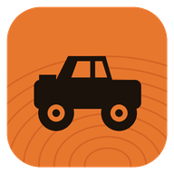
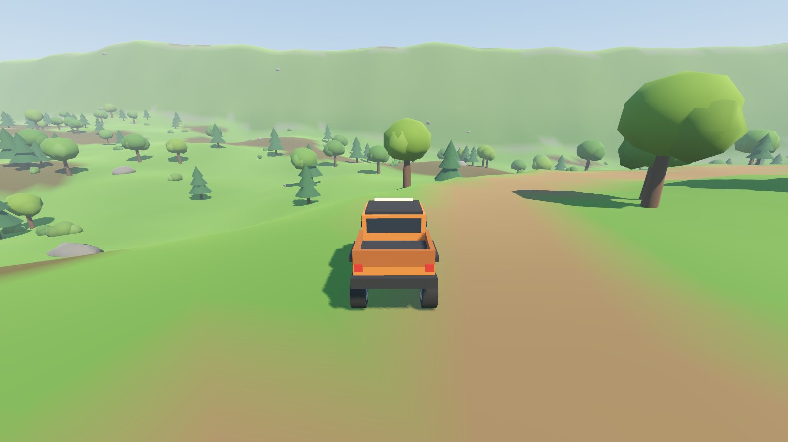

<p align="center">
  
</p>

<h1 align="center">Driver</h1>

<p align="center">
  Off-road driving for Windows. Play solo or with up to three friends over LAN or Tailscale.<br>
  <a href="https://bhxuk.github.io/driver/">Website</a> ·
  <a href="https://github.com/bhxuk/driver/releases/latest/download/Driver-Setup.exe">Download for Windows</a>
</p>

<p align="center">
  
</p>

## What it is

Driver is a small, chunky off-road game. Each player gets their own truck. You crawl through mud, climb snowy switchbacks and bounce across canyon dunes, help each other out with the winch, and work together on routes, deliveries and landmarks.

- **Three maps:** Green Hollow (forest, mud, river crossing), Red Canyon (desert dunes and mesas), Frostline Peak (snow, ice and a summit).
- **Free roam** across every map, with trails, rough ground and hidden landmarks to find.
- **Routes:** stop in a yellow gate to start a timed checkpoint run. In co-op the whole convoy has to reach the finish. Best times are saved.
- **Deliveries:** stop on a blue depot pad to load cargo, then get it to the green destination. Knocks and rollovers damage it, and the pay drops with it.
- **Winch:** hook onto trees, rocks, buildings or a friend's truck and reel yourself (or them) out of trouble.
- **Surfaces matter:** mud, soft sand and ice all grip differently. Water slows you down.
- **Co-op for up to 4** over your local network or Tailscale. No accounts, no servers.
- Keyboard and controller, fully rebindable. Procedural engine sound, headlights, horn.

## Install

1. Download **[Driver-Setup.exe](https://github.com/bhxuk/driver/releases/latest/download/Driver-Setup.exe)** from the latest release.
2. Run it. Windows SmartScreen may warn because the installer is not code signed: choose **More info**, then **Run anyway**.
3. Setup adds a Start menu entry, a desktop shortcut and a Windows Firewall rule so friends can join you.

A portable `Driver-portable.exe` is also attached to each release if you would rather not install.

## Playing co-op

Driver uses direct connections, so everyone needs to be on the same network or the same Tailscale tailnet.

**Host**
1. Choose **Host co-op**, keep the port as `24560` unless you need another, and press **Start hosting**.
2. The lobby lists your addresses. Give friends your LAN address (for example `192.168.1.20`) or your Tailscale address (`100.x.y.z`).
3. Pick a map and press **Start**. Friends can also join a game that is already running.

**Join**
1. Choose **Join co-op**, enter the host's address and port, and press **Join**.

**Tailscale:** install Tailscale on every PC, sign in to the same tailnet (or share the host's machine), then join using the host's `100.x.y.z` address. No port forwarding needed.

**Trouble connecting?** Check the host allowed Driver through Windows Firewall (the installer does this), that UDP port `24560` is not blocked, and that everyone is on the same version.

## Controls

| Action | Keyboard | Controller |
| --- | --- | --- |
| Accelerate / brake and reverse | W / S (or arrows) | RT / LT |
| Steer | A / D | Left stick |
| Handbrake | Space | A |
| Winch attach or release | F | Y |
| Winch reel in / let out | G / H | RB / LB |
| Flip upright (hold) | R | X |
| Respawn on trail | Backspace | View |
| Headlights / horn | L / E | D-pad up / LS click |
| Camera | Mouse, C to switch, wheel to zoom | Right stick, RS click |
| Map / pause | M / Esc | D-pad down / Menu |

Everything can be rebound in **Settings > Controls**. Aim the winch with the camera: it hooks the nearest anchor in the direction you are looking.

## Swapping in Quaternius models

The game ships with simple generated low-poly models. You can replace them with free [Quaternius](https://quaternius.com) packs (or any `.glb` / `.gltf` models) without touching code. See [assets/README.md](assets/README.md) for the folder names. Models are scaled and placed automatically.

## Building from source

Requirements: [Godot 4.7.2](https://godotengine.org/download) with Windows export templates, and NSIS (`makensis`) for the installer.

```bash
GODOT=/path/to/godot tools/build.sh
# build/windows/Driver.exe and build/Driver-Setup.exe
```

To play from source, open the folder in Godot and press Play. Pushing a tag like `v0.1.1` builds and publishes a release through GitHub Actions.

Handy command line options for testing (after `--`): `--solo --map=desert`, `--host --map=snow`, `--join=192.168.1.20`, and `--selftest --map=forest` which drives, flips, winches and runs every objective, then prints a report.

## Project layout

```
scripts/autoload   settings, input bindings and networking
scripts/world      terrain generation, props, objectives, markers, maps
scripts/vehicle    the local truck, friends' trucks, truck visuals, engine audio
scripts/ui         menus, lobby, HUD, map, settings
docs/              the website (GitHub Pages)
installer/         NSIS installer script
```

## Licence

[MIT](LICENSE)
